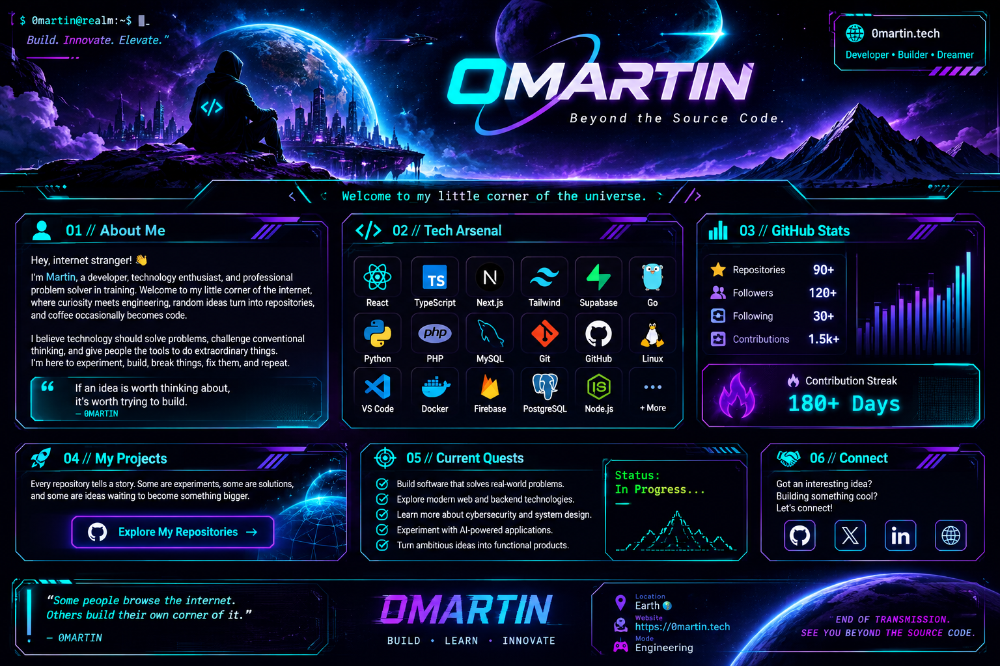

\<!--   0MARTIN | THE DIGITAL REALM   Theme: Cyberpunk / Neon / Deep Space   Colors: Cyan #00F7FF | Purple #9D4EDD | Black #080611 -->

\<div align="center">

\

\<br/>

\

\<br/>

\<a href="[https://0martin.tech](https://0martin.tech)">
\
\</a>
\<a href="[https://github.com/Martin-mart?tab=repositories](https://github.com/Martin-mart?tab=repositories)">
\
\</a>

\<br/>\<br/>

\
\
\

\</div>

---

\<div align="center">

# `01 // TRANSMISSION RECEIVED`

### \

\</div>

```bash
┌──[0martin@realm]─[~/identity]
└──$ whoami

Martin
Software Developer | Technology Enthusiast
Curious Mind | Builder of Digital Experiences

┌──[0martin@realm]─[~/identity]
└──$ cat introduction.txt
```

Hey, internet stranger! 👋

I'm Martin, a developer who enjoys turning ideas into functional digital experiences.

I spend my time exploring software engineering, building applications, experimenting with emerging technologies and figuring out how things work under the hood.

I believe in learning by building, solving real problems and pushing my technical abilities further with every project.

> If an idea is worth thinking about, it's worth trying to build.

---

\<div align="center">

# `02 // DEVELOPER PROFILE`

\</div>

\<table width="100%">
\<tr>
\<td width="50%" valign="top">

### ◈ IDENTITY

```yaml
name: Martin
alias: 0martin
role: Software Developer
base: Earth 🌍
website: 0martin.tech
status: Always building
```

\</td> \<td width="50%" valign="top">

### ◈ AREAS OF INTEREST

- Full-Stack Development
- Software Engineering
- Cybersecurity
- Artificial Intelligence
- Database Engineering
- Systems Architecture
- Open Source

\</td> \</tr> \</table>

---

\<div align="center">

# `03 // TECHNOLOGY ARSENAL`

\

\<br/>\<br/>

### FRONTEND ENGINEERING

\

### BACKEND ENGINEERING

\

### DATABASES & CLOUD

\

### DEVELOPMENT ENVIRONMENT

\

\</div>

---

\<div align="center">

# `04 // PROJECTS FROM THE REALM`

### DIGITAL EXPERIMENTS. REAL-WORLD SOLUTIONS.

\</div>

I build applications, explore new technologies and turn ambitious concepts into working software.

\<table width="100%"> \<tr> \<td width="50%" valign="top">

### ◈ SOFTWARE SYSTEMS

Building platforms, dashboards, management systems and tools designed to solve everyday problems.

\

\</td>
\<td width="50%" valign="top">

### ◈ EXPERIMENTAL BUILDS

Exploring AI, automation, cybersecurity and new approaches to software development.

\

\</td>
\</tr>
\</table>

\<div align="center">

\<a href="[https://github.com/Martin-mart?tab=repositories](https://github.com/Martin-mart?tab=repositories)">
\
\</a>

\</div>

---

\<div align="center">

# `05 // GITHUB TELEMETRY`

### LIVE DEVELOPER STATISTICS

\

\

\<br/>\<br/>

\

\<br/>\<br/>

\

\</div>

---

\<div align="center">

# `06 // CURRENT MISSIONS`

\</div>

\<table width="100%"> \<tr> \<td width="50%" valign="top">

### [01] BUILD

\

- Build useful software products.
- Develop full-stack applications.
- Improve backend engineering skills.

\</td> \<td width="50%" valign="top">

### [02] EXPLORE

\

- Explore cybersecurity.
- Experiment with artificial intelligence.
- Study system architecture.
- Contribute to open source.

\</td> \</tr> \</table>

```bash
[MISSION LOG]

> Learn something new       [ACTIVE]
> Build something useful    [ACTIVE]
> Solve real problems       [ACTIVE]
> Repeat                    [INFINITE]
```

---

\<div align="center">

# `07 // ESTABLISH CONNECTION`

### EVERY GREAT BUILD STARTS WITH AN IDEA.

Have an interesting project? Want to collaborate? Interested in technology?

Let's connect.

\<br/>

\<a href="[https://0martin.tech](https://0martin.tech)">
\
\</a>

\<a href="[https://github.com/Martin-mart](https://github.com/Martin-mart)">
\
\</a>

\<br/>\<br/>

\<a href="[https://github.com/Martin-mart](https://github.com/Martin-mart)"> \ \</a>

\</div>

---

\<div align="center">

\

### `0MARTIN // END OF TRANSMISSION`

**BUILD. LEARN. INNOVATE. REPEAT.**

\<code>01001111 01001101 01000001 01010010 01010100 01001001 01001110\</code>

\<br/>

\<sub>© 2026 0MARTIN | Beyond the Source Code.\</sub>

\</div>
